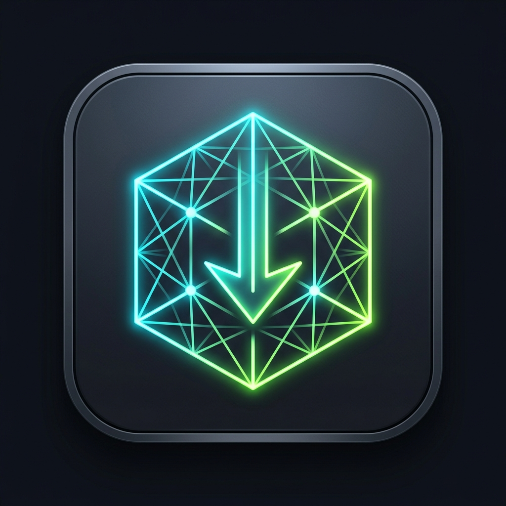

<p align="center">
  
</p>

<h1 align="center">3D Model Asset Downloader</h1>

<p align="center">
  <a href="#technical-architecture"></a>
  <a href="#privacy--security"></a>
  <a href="#privacy--security"></a>
  <a href="https://buy.stripe.com/dRm8wI8Hk0wq3Y692vcEw0h"></a>
</p>

A high-performance, privacy-focused browser extension for extracting and exporting 3D assets and PBR texture maps from **Meshy AI** and **Tripo3D Studio** into production-ready formats (**GLB**, **OBJ + MTL**, **FBX**, **STL**, **3MF**).

---

## Key Capabilities

- **Zero-Cloud Processing**: All geometry conversion, texture baking, and `.zip` archive creation occur 100% client-side in your browser via Three.js and fast DEFLATE algorithms.
- **Complete Material Packaging**: OBJ and FBX exports are packaged into `.zip` archives containing the geometry, `.mtl` material definitions, and dedicated PBR texture maps (`diffuse`, `normal`, `roughness`, `metallic`).
- **All-In-One Full Pack**: One-click download bundling every supported format and texture map into a single organized archive.
- **Viewer Memory Sniffing**: Intercepts raw `glTF` buffers from 3D viewer Web Workers, unlocking Community models even when direct file links are omitted.
- **Tripo3D Studio Integration**: Detects project definitions and surfaces available formats directly.
- **No Metering or DRM**: No account restrictions, artificial export quotas, or external telemetry servers.

---

## Quick Start

### Installation

1. Clone or download this repository to a local folder.
2. Open your Chromium-based browser (Chrome, Brave, Edge).
3. Navigate to the extensions page:
   - Chrome: `chrome://extensions`
   - Brave: `brave://extensions`
   - Edge: `edge://extensions`
4. Toggle **Developer mode** on (top-right corner).
5. Click **Load unpacked** and select the root directory of this extension.

---

## Usage Guide

### 1. Meshy AI Workspace (Your Generated Models)
1. Go to [meshy.ai/workspace](https://www.meshy.ai/workspace).
2. Generate a new asset or select an existing one.
3. Open the extension popup from your toolbar.
4. Choose your format (`GLB`, `OBJ`, `FBX`, `STL`, `3MF`) and click **Download**, or click **Download All (.zip)** for the entire production pack.

### 2. Meshy AI Community (`/posts/...`)
1. Open any public showcase post on Meshy.
2. The extension's background observer intercepts the model directly from the page memory and viewer worker.
3. Open the popup to export the community model in your chosen format with all associated textures.

### 3. Tripo3D Studio (`studio.tripo3d.ai`)
1. Open any generated 3D project (`/3d-model/...`).
2. Open the extension popup to access extracted formats and download the model.

---

## Export Format Matrix

| Format | Delivery | Contents | Best Suited For |
| :--- | :--- | :--- | :--- |
| **GLB** | Standalone `.glb` | glTF 2.0 binary with embedded textures & materials | Modern web engines, Three.js, Godot, Blender |
| **OBJ** | Compressed `.zip` | `model.obj`, `model.mtl`, and `textures/` folder | Blender, Maya, 3ds Max, ZBrush |
| **FBX** | Compressed `.zip` | `model.fbx` with bundled PBR texture maps | Unity, Unreal Engine, animation pipelines |
| **STL** | Standalone `.stl` | Watertight binary triangle mesh | 3D printing slicers (Cura, PrusaSlicer, Bambu Studio) |
| **3MF** | Standalone `.3mf` | Production 3D Manufacturing XML archive | Advanced additive manufacturing & multi-part printing |
| **Textures** | Compressed `.zip` | Color, Normal, Roughness, and Metallic PNG maps | Custom material graph shading |
| **Full Pack** | Compressed `.zip` | Every format above + all PBR texture maps | Archiving and multi-engine distribution |

---

## Technical Architecture

The extension is structured around an asynchronous, non-blocking pipeline:

```
[ Webpage: MAIN World ]
       │
       ├── page-hook.js ────── (Intercepts fetch/XHR & Web Worker glTF magic bytes)
       │                              │ window.postMessage
[ Extension: ISOLATED World ]         ▼
       ├── content-bridge.js ── (Resolves Supabase JWT, route state & storage)
       │                              │ chrome.storage.local
[ Extension Context ]                 ▼
       ├── background.js ───── (Handles resilient service-worker file streaming)
       └── popup.js / converters.js (Three.js geometry baking & fflate compression)
```

- **`page-hook.js`** (`world: MAIN`): Injected at `document_start`. Hooks `window.fetch`, `XMLHttpRequest`, and `window.Worker` messages for the glTF magic header (`0x46546C67`) to capture geometry buffers transparently.
- **`content-bridge.js`** (`world: ISOLATED`): Extracts session cookies (`sb-*-auth-token`), routes data through `chrome.storage.local`, and acts as a bridge for buffer requests.
- **`background.js`**: Manifest V3 Service Worker managing tab lifecycle, script re-injection, and background download hand-offs.
- **`converters.js`**: Parses glTF geometry into vertex/normal/UV arrays, bakes world transformations, generates Wavefront/FBX/STL/3MF outputs, and compiles `.zip` payloads using `zipSync`.
- **`fbx-writer.js`**: Standalone ASCII FBX 7.4 generator with coordinate-system normalization.

---

## Privacy & Security

- **No Remote Servers**: Zero external API endpoints, telemetry pings, or analytics trackers.
- **No Data Harvesting**: Your session tokens and model data never leave your local browser instance.
- **Minimal Permissions**: Operates exclusively under necessary domain scopes (`meshy.ai`, `tripo3d.ai`) and explicit Chrome API permissions (`downloads`, `storage`, `scripting`, `cookies`).

---

## Support & Donations

If this tool accelerates your 3D workflow and helps your creative projects, consider supporting its maintenance and future improvements:

[](https://buy.stripe.com/dRm8wI8Hk0wq3Y692vcEw0h)

[](https://buy.stripe.com/dRm8wI8Hk0wq3Y692vcEw0h)

Direct link: [**buy.stripe.com/dRm8wI8Hk0wq3Y692vcEw0h**](https://buy.stripe.com/dRm8wI8Hk0wq3Y692vcEw0h)

---

## License

This project is distributed for educational and personal workflow efficiency purposes. All product names, logos, and brands (Meshy, Tripo3D) belong strictly to their respective owners.
